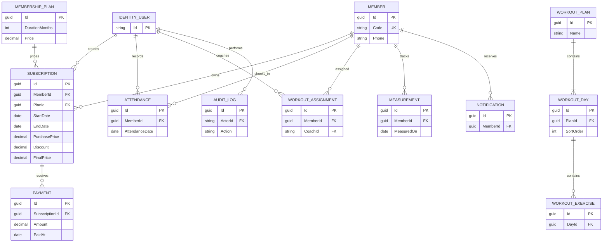

# قرارات تأسيس FitManager

## نطاق MVP والأدوار

يشمل الإصدار الأول إدارة الأعضاء والخطط والاشتراكات والدفعات والحضور، ثم التدريب والقياسات والتنبيهات داخل التطبيق ولوحة المؤشرات والتقارير وCSV. الأدوار هي Admin وCoach. يدير Admin الحسابات والبيانات والتقارير المالية؛ يرى Coach بيانات التدريب والأعضاء المصرح له بهم فقط. التسجيل الذاتي غير متاح. يفرض الخادم الصلاحية على كل عملية؛ إخفاء عناصر الواجهة تحسين تجربة فقط.

ترتيب التنفيذ: التأسيس والمصادقة، الأعضاء والاشتراكات، الدفعات والحضور، التدريب والقياسات، التقارير، ثم الجودة والتسليم. الواجهة React/TypeScript عميل مستقل، والخادم مقسم إلى API وApplication وInfrastructure. SQL Server هو مخزن MVP.

## سياسات المجال

- **الزمن:** تُحفظ لحظات الإنشاء والتحديث بصيغة UTC (`DateTimeOffset`). أيام العضوية والحضور والفترات هي `DateOnly` حسب التقويم المحلي للنادي. المنطقة الزمنية الافتراضية للنادي هي `Africa/Cairo` وتُضبط من إعداد `Club:TimeZoneId` عند النشر؛ لا يُستنتج اليوم المحلي بتحويل تاريخ UTC ضمنيًا. إذا تغيرت المنطقة، تسري السياسة الجديدة على العمليات اللاحقة فقط.
- **حدود اليوم:** تاريخ الحضور المحلي شامل من بداية اليوم إلى نهايته. فترات الاشتراك شاملة لتاريخ البداية والنهاية؛ تنتهي الصلاحية بعد نهاية تاريخ الانتهاء في تقويم النادي.
- **الأشهر:** الإضافة تقويمية. عند غياب اليوم في الشهر الهدف يُستخدم آخر يوم فيه (مثل 31 يناير + شهر = 28/29 فبراير). تنتهي فترة مدتها N شهرًا في اليوم السابق لتاريخ البداية بعد إضافة N أشهر؛ التجديد المبكر يبدأ اليوم التالي لنهاية الفترة الحالية.
- **الهاتف:** يُخزن كنص مع الاحتفاظ بعلامة + والأصفار البادئة. لا يُفرض التفرد في MVP لأن العائلات قد تشترك برقم هاتف؛ يستخدم البحث تطبيعًا لاحقًا مع حفظ القيمة الأصلية، ويعتمد كود العضو الفريد على منع الالتباس.
- **المال والتقارير:** العملة EGP، وتخزن القيم `decimal(12,2)`. سعر وخصم الشراء يثبتان في سجل الاشتراك. تقارير التحصيل تُعرّف بحسب تاريخ تسجيل الدفعة، ولا تساوي قيمة الاشتراكات المباعة.
- **الأرشفة والتاريخ:** تُؤرشف سجلات الأعضاء بدل الحذف؛ قيود المفاتيح تمنع حذف السجلات التي لها تاريخ مالي أو تشغيلي. يسجل التدقيق العمليات الإدارية الحساسة.

## مخطط بيانات أولي

هذا مخطط مفاهيمي أولي؛ تُثبت تفاصيل الحقول والعلاقات في مراحل الوحدات قبل إنشاء migrations الخاصة بها.

## التشغيل المحلي والبيانات

يتطلب الخادم .NET 10 وSQL Server/LocalDB. يتطلب العميل Node.js 20.19 أو أحدث وnpm. لا تُضاف بيانات اعتماد افتراضية أو حقيقية إلى Git. ينشأ Admin محليًا عبر `Seed:Admin:*` بعد اختيار المالك لكلمة المرور، ثم يوقف seed. تُضاف البيانات الخيالية مع مخطط المجالات في المراحل التالية، كي تبقى المفاتيح والعلاقات صحيحة.
